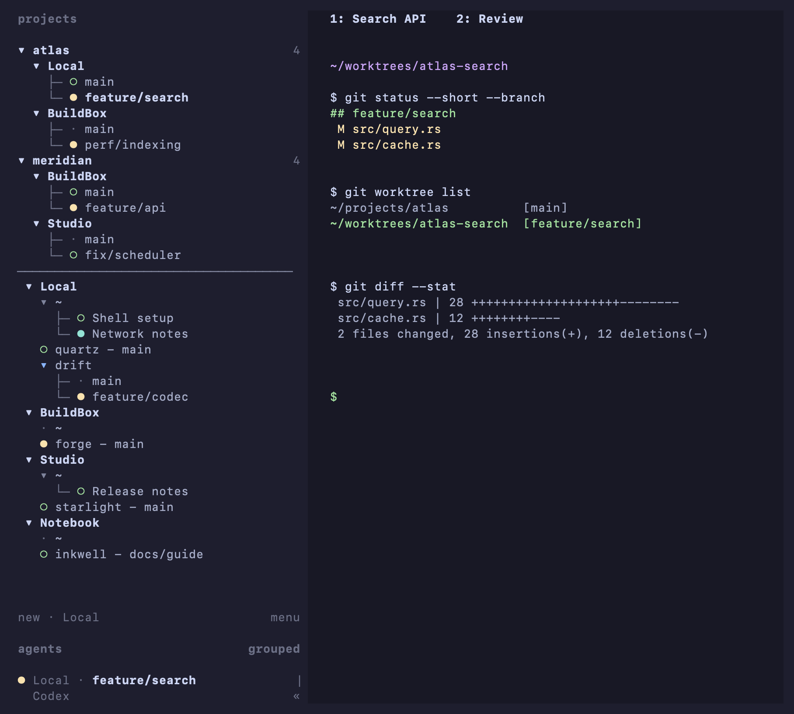

# Herdr fork with opinioned sidebar



*Simulated English session rendered with the custom client's sidebar: two shared projects, four machines, home groups, and projects with one or multiple checkout workspaces.*

Personal client customizations for [Herdr](https://github.com/herdrdev/herdr), based on official `v0.9.5`:

- Group shared projects by name across Local and SSH machines.
- Place single-machine projects below shared projects, separated by a divider.
- Show checkouts directly under each machine, with tree markers and the main repo's branch first.
- Highlight the machine row belonging to the selected checkout's project.
- Nest renamed home workspaces under `~`, always first under each machine.
- Keep project and home collapse controls on the left.
- Show one checkout as `project - branch`, or multiple checkouts as a branch tree.
- Recreate a missing home shell while the custom client is connected.
- Open workspace context menus directly across machines with one right-click.
- Hide online-machine dots while keeping offline and error indicators.
- Remember grouping and collapsed sections across client launches.
- Detach idle clients after a configurable timeout, keeping panes and agents running.

All customizations are client-side; the server stays official.

## Project-oriented Spaces

In **Settings → Spaces**, choose **By name** to group workspaces with the same name across the local machine and saved SSH machines. Projects present on multiple machines show a project heading, then each machine and its checkouts as direct sibling tree rows. The main repository is always first and shows only its branch row, followed by one row per worktree. Projects present on only one machine appear together under that machine's heading. A single checkout workspace shows `project - branch` on one line; multiple checkout workspaces show a project heading with the main branch and worktrees as sibling tree rows. Only checkouts with an open Herdr workspace count. Home (`~`) always appears under its machine, even when other machines also have a home workspace.

Shared projects always appear first, with a horizontal divider before the machine-organized section. Home (`~`) is the first workspace under each machine. The highlighted machine row belongs to the selected workspace's group: selecting a checkout in a shared project highlights that project's machine row.

Non-project workspaces are grouped under their machine's `~` when the top-left pane in their first tab is in the home directory, including renamed workspaces. Other tabs and panes do not affect this grouping. An unbound workspace named `~` always owns the home group, even after changing directories; explicit worktree membership keeps its project grouping. Workspace labels are preserved. If there is no actual `~` workspace, a client-only home heading holds them. Project and home collapse controls appear on the left.

Single-machine project and home rows are indented beneath their machine. A row with children shows a collapse arrow instead of an agent status indicator; individual checkout/workspace rows show agent status. A home workspace without children shows its status and has no collapse arrow.

Each machine always has a `~` heading. While this custom client is running and connected, it recreates a missing real home shell workspace through the existing JSON API. The client embeds a one-shot Python 3 helper and uses SSH for saved remote machines; a per-user lock coordinates simultaneous clients. No server changes or resident helper are needed, and creating `~` keeps the current focus. Remote machines need Python 3. Closing all custom clients stops automatic home-workspace maintenance.

Right-clicking a workspace on another machine selects it and opens its context menu directly. Rename, close, and worktree actions then apply to that machine's workspace.

Grouping and collapsed sections are saved as client preferences. Workspaces and their processes stay on their original machines, and compatible remote servers need no update for this view.

## Automatic client detach when idle

Set a timeout in `config.toml` on the machine running the client process:

```toml
[ui]
idle_detach_minutes = 30
```

The client detaches after the configured period without local keyboard, mouse, paste, focus, or terminal resize activity. Agent output and server updates do not reset the timer. Detaching leaves the server, panes, and agents running; launch Herdr again to reconnect. The default is `0`, which disables automatic detach.

Related discussion: [herdrdev/herdr#4556](https://github.com/herdrdev/herdr/discussions/4556).
